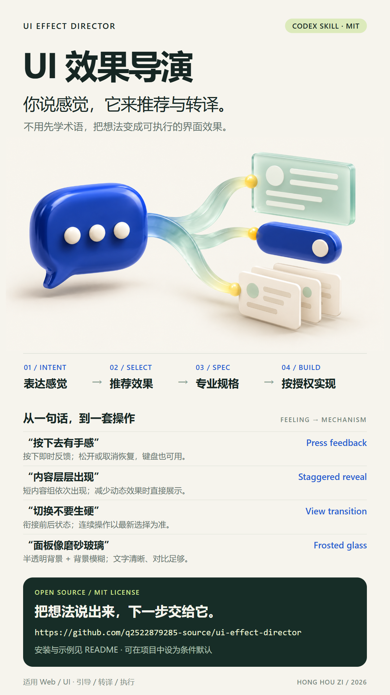

# UI 效果导演

**不用先学术语，把“我想要这种感觉”变成可实现的界面效果。**

自然语言 → 推荐效果 → 专业规格 → 按授权实现。

[](poster.png)

## 它怎么帮你

- **引导**：你说“高级一点”“跟手”“切换别太生硬”，它结合用途推荐一个合适的效果；适合静态时不硬加动画。
- **转译**：把你描述的现象对应到专业术语，补清触发、状态、中断、键盘、低动态偏好和验收；只问名称时也能一句话回答。
- **执行**：你明确指定项目并要求实现后，沿用现有技术栈与组件完成改动和检查，不停在建议或代码片段。

它先判断交互语义，再选动画或材质。例如“侧边滑出一块”只说明形态，还要区分打开后背景能否操作；“磨砂玻璃”不等于模态对话框。

这是效果选择与规格交接 Skill，不替代整个网站的设计系统，不接管纯逻辑 bug 修复或影视提示词。参考图和调研请求不自动授权修改项目。

## 安装

适用于支持 `SKILL.md` 的编码 Agent。以 Codex 为例，在终端执行：

```bash
npx skills add https://github.com/q2522879285-source/ui-effect-director
```

该命令使用第三方 `skills` CLI；安装范围与目标客户端以它的交互提示为准。也可以手动安装，无需该 CLI：

1. 下载本仓库，或 `git clone https://github.com/q2522879285-source/ui-effect-director.git`。
2. 把仓库目录放进客户端的 Skill 目录，目录名保持 `ui-effect-director`。
3. 确认最终路径为 `<Skill 目录>/ui-effect-director/SKILL.md`，重新载入客户端。

Codex 常见用户目录为 `~/.codex/skills/`；设置 `CODEX_HOME` 时使用 `$CODEX_HOME/skills/`。其他客户端请按其当前文档选择目录。

## 直接复制这些请求

**先推荐，不改代码**

```text
用 $ui-effect-director 帮我看看后台统计卡片。
希望高级一点，但每天都要用，别花里胡哨。
先推荐一个方案，说清看起来怎样，不修改项目。
```

**把感觉变成专业操作描述**

```text
用 $ui-effect-director 转译这个效果：
点标签时，下面的选中线滑过去，内容不要生硬切换。
给我专业名称和可直接交给编码 Agent 的操作描述，包含连续切换、键盘与减少动态效果时的行为。
```

**跟手拖动，不误用慢动画**

```text
用 $ui-effect-director 写规格：
卡片拖动时跟着指针走，松手后轻微回弹，不要等预设动画播完。
限制在容器内，允许取消，提供非拖动的替代操作。暂不修改项目。
```

**在指定范围内实现**

```text
用 $ui-effect-director 在当前项目实现设置面板的展开/收起效果。
保留现有布局、组件与 design token，不安装新依赖。
连续点开/关/开时状态要正确，键盘可用，减少动态效果时保留功能。
完成后报告修改文件、实际检查结果和未验证项。
```

截图只能证明可见形态，不能证明源页面的时长、缓动、触发方式或框架。视频也只按实际可见行为推断。

## 自动发现与项目约定

[agents/openai.yaml](agents/openai.yaml) 设置了 `allow_implicit_invocation: true`，允许支持它的客户端根据任务描述自动发现此 Skill；这不是强制触发保证。想明确使用时，在请求中写 `$ui-effect-director`。

如果希望在项目中建立更明确的条件规则，可把这段加入你自己的 `AGENTS.md`：

```text
制作或改造 Web 页面、界面组件与交互，需要选择效果或转译自然语言感觉时，
读取并应用可用的 ui-effect-director Skill。
已有明确效果直接转译或执行，不增加无意义的术语选择环节。
纯逻辑 bug、影视提示词和无关任务不触发；项目修改仍以当前用户授权为准。
```

安装本仓库不会安装或修改 hooks、全局 defaults、其他 Skill 或客户端配置。

## 可选实现适配

本仓库独立提供引导、转译、效果地图和规格交接，不打包这些外部 Skill：

| 可选适配 | 用途 |
|---|---|
| `$impeccable` | 产品、后台、设置、表单的整体视觉与 UX |
| `$design-taste-frontend` | 品牌站、营销页、作品集的整体视觉 |
| `$animate` | Web 动效实现 |
| `$web-access` | 官方资料与当前 API 能力核实 |

有这些 Skill 时读取其当前指令后使用；缺少时不自动安装、不假装已执行其工作流。引导和转译仍可完成；实际实现可由当前 Agent 按项目现有工程方式承担。若缺少目标代码、浏览器或资料查询能力，明确交付规格、实际文件及具体未验证项，不把“已写代码”说成“视觉已验收”。

## 包内内容

- [SKILL.md](SKILL.md)：入口与引导、转译、执行流程。
- [效果地图](references/effect-map.md)：状态反馈、导航展开、滚动拖动、材质层级。
- [交互规格](references/interaction-spec.md)：状态、中断、操作契约、验收与实现交接。
- [使用示例](references/examples.md)：从用户说法到推荐与操作描述。
- [一图流海报](poster.png)：1080 × 1920，点击预览查看原图。
- [排版源文件](poster.html)、[视觉原图](assets/hero.png)与[视觉提示词](assets/hero-prompt.md)：可自行调整文字与版式。

## 许可证

[MIT](LICENSE) · Copyright © 2026 hong hou zi
